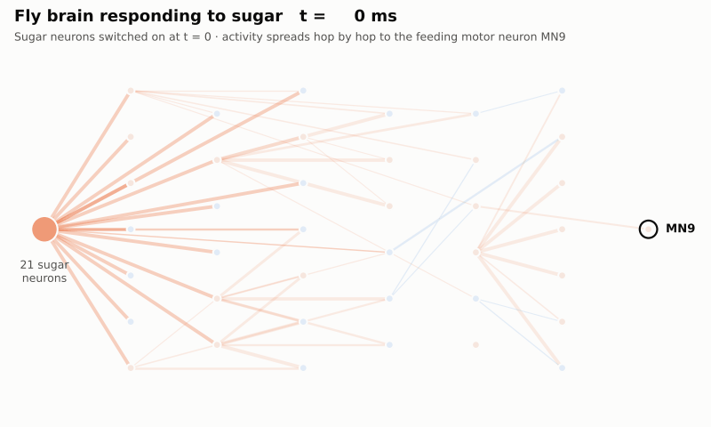
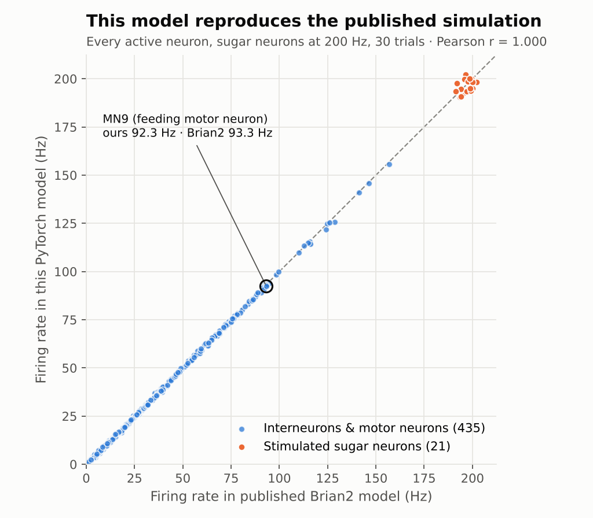
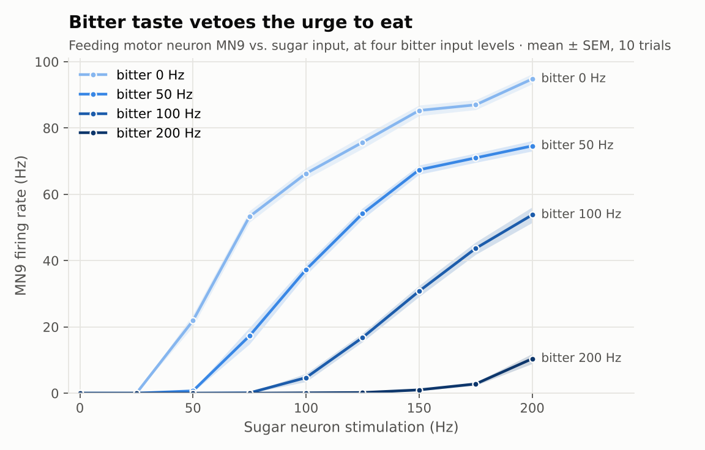
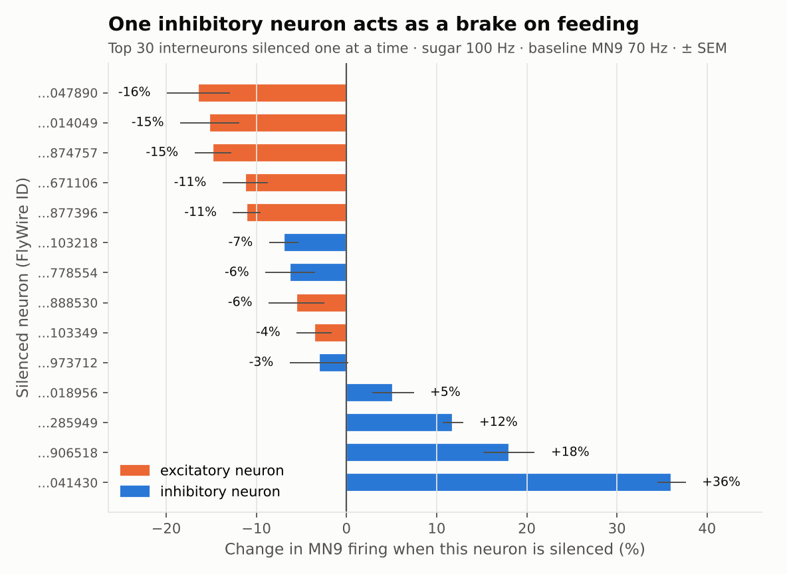
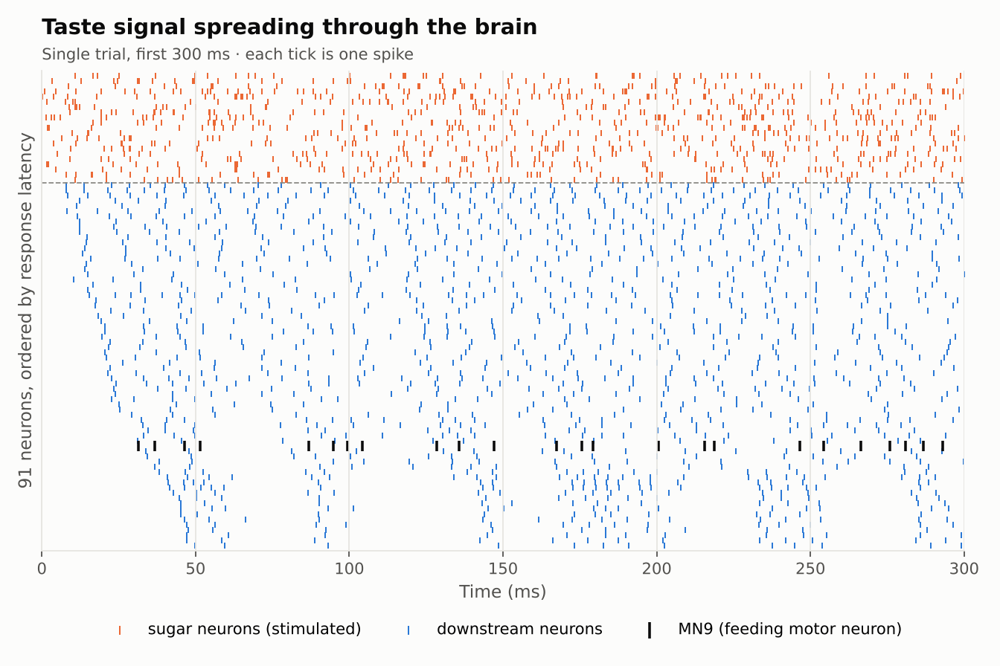
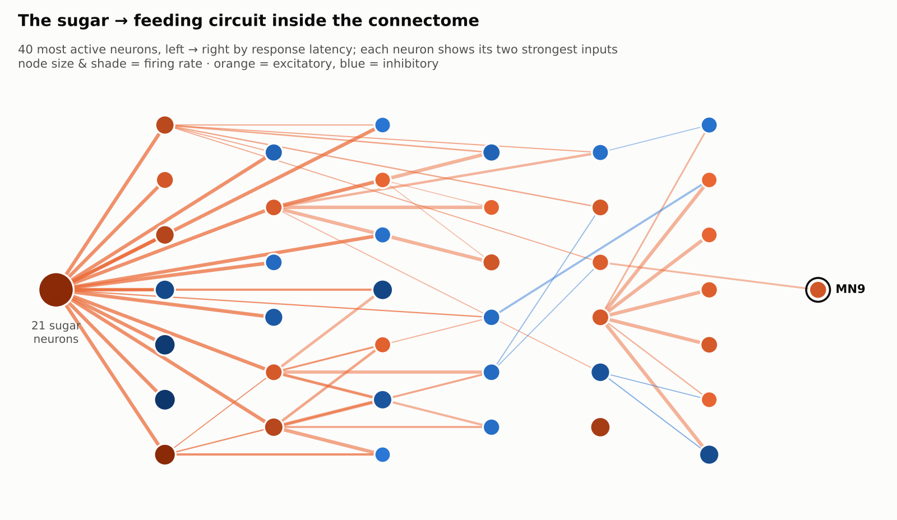

# FlyWire Brain Sim


**A spiking simulation of the entire fruit fly brain — 127,400 neurons and 14.7 million connections — in PyTorch.**

Every neuron and synapse comes from the [FlyWire](https://flywire.ai) connectome, the first complete wiring diagram of an adult brain. Nothing is trained: each neuron is the same simple leaky integrate-and-fire unit, and the behaviour below emerges from the wiring alone. Switch on the fly's sugar-sensing neurons and, a few synapses later, the motor neuron that extends its proboscis ("tongue") starts firing.



This is a from-scratch PyTorch re-implementation of the model by [Shiu et al. (2024, *Nature*)](https://www.nature.com/articles/s41586-024-07763-9). It reproduces their published Brian2 results almost exactly (r = 0.9999 over every responding, non-stimulated neuron), runs several trials in parallel as a batch, and runs on CPU or GPU.

## Results

### 1. It reproduces the published model



Sugar neurons stimulated at 200 Hz, 30 trials. Every point is one neuron; the x-axis is the published Brian2 simulation, the y-axis is this code. The feeding motor neuron MN9 fires at **92.3 Hz here vs. 93.3 Hz** in the original.

Getting there taught me a subtle detail: my first version was correlated (r ≈ 0.97) but ran 20–50 % too hot. Comparing both simulators spike by spike on a 3-neuron chain showed that Brian2 **discards synaptic input that arrives while a neuron is refractory** (variables marked `unless refractory`), while my code was letting it accumulate. One line fixed it.

### 2. Bitter taste vetoes feeding



MN9 rises with sugar input, and adding bitter input pushes it back down — the same "sweet but bitter → don't eat" logic a real fly shows. The veto is graded: with sugar at 100 Hz, MN9 drops from 66 Hz (no bitter) to 37 Hz with bitter at 50 Hz and to ~5 Hz at 100 Hz; with bitter at 200 Hz even maximal sugar barely moves it (10 Hz). Below ~25 Hz of sugar MN9 stays silent — the circuit behaves like a threshold, not a linear amplifier.

### 3. Which neurons does the circuit depend on?



Each of the 30 most active interneurons was silenced on its own (its outgoing synapses removed) while the sugar neurons fired at 100 Hz; the chart shows the 14 largest effects. None of them is essential: removing a single excitatory neuron lowers MN9 by at most 16 %, so the sugar signal reaches the motor neuron through many parallel paths. The strongest effect goes the other way: silencing one inhibitory neuron (`720575940615041430`) raises MN9 by **36 %** — it acts as a brake on the feeding command. Try it yourself with the `--set "silence=[...]"` example below.

### 4. How the signal travels



One trial, first 300 ms. Sugar neurons (orange) fire from the start; downstream neurons join in order of their distance from the input. (Single trials show wave-like bursts; averaged over 30 trials there is no clear rhythm.) MN9 is only **2 synapses** away from the sugar neurons (3 if we count only connections with ≥ 5 synapses) and typically fires its first spike about **31 ms** after the stimulus starts.



The 40 most active neurons, placed left to right by when they respond; colour shows whether a neuron excites (orange) or inhibits (blue) its targets. For readability each neuron is drawn with only its two strongest inputs (MN9 with four) — in reality MN9 receives input over many parallel paths, which is why silencing any single neuron barely matters.

## Quick start

```bash
git clone https://github.com/emrezorlu1239/flywire-brain-sim.git
cd flywire-brain-sim
pip install -r requirements.txt

python run.py                 # first run downloads the connectome (~90 MB)
```

> **NVIDIA GPU:** `pip install -r requirements.txt` may install a CPU-only PyTorch (always the case on Windows). For CUDA, install PyTorch first with the command from [pytorch.org](https://pytorch.org/get-started/locally/), e.g. `pip install torch --index-url https://download.pytorch.org/whl/cu128`.
>
> **Windows:** if `python` says `No module named 'numpy'` although `pip` installed it, `python` points to a different interpreter than `pip`. Use `py -3.11 run.py` (your version) or `python -m pip install ...` with the same `python`.

`run.py` reads [`config.yaml`](config.yaml): which neurons to stimulate and how hard, which to silence, and the neuron constants. It prints the read-out neurons and the most active neurons, and saves a CSV and a raster plot to `results/playground/`. Any value can be overridden from the command line:

```bash
python run.py --set stimulate.sugar=150 --set stimulate.bitter=100
python run.py --set neuron.weight_mV=0.35            # stronger synapses
python run.py --set "silence=[720575940615041430]"    # knock out one neuron
```

Reproduce everything in this README:

```bash
python experiments.py     # ~25 min on a 2-core CPU
python make_figures.py
python -m pytest -q       # tiny hand-built networks + config checks, no download needed
```

Misspelled settings are rejected (`--set neuron.v_treshold=-40` → *Did you mean 'v_threshold'?*), so a typo can never silently run the default model.

**CPU or GPU?** Each simulated millisecond is 10 sequential steps that each touch only a few hundred spiking neurons, so a GPU spends most of its time on per-step overhead. Measured on an RTX 5060 laptop: with 10 trials the CPU was faster (20 s vs. 30 s); with 60 trials the GPU took the same 31 s, while CPU time grows with the number of trials. Rule of thumb: few trials → `simulation.device=cpu`, many trials → `cuda`.

## How it works

Each neuron has a membrane voltage `v` and a synaptic input `g`:

```
dv/dt = (v_rest - v + g) / tau_m        tau_m   = 20 ms
dg/dt = -g / tau_syn                    tau_syn = 5 ms
```

When `v` crosses −45 mV the neuron spikes, resets to −52 mV and stays silent for 2.2 ms. After a 1.8 ms delay each postsynaptic partner's `g` jumps by `0.275 mV × (number of synapses)`, positive for excitatory (acetylcholine) and negative for inhibitory (GABA, glutamate) neurons. "Stimulating" a neuron drives it with random Poisson spikes; "silencing" removes its outgoing synapses. That is the whole model.

Implementation choices that make it fast:

| Idea | Why |
|---|---|
| **Exact integration** | Between spikes the equations are linear, so each 0.1 ms step uses the closed-form solution — no Euler error. Identical to Brian2's `method='linear'`. |
| **Event-driven synapses (CSR)** | Connections are stored by presynaptic neuron. Each step gathers only the synapses of neurons that actually spiked and scatter-adds them, instead of a 127k × 127k matrix product. |
| **Ring buffer for delays** | Future input is written into a small circular buffer indexed by arrival time step. |
| **"Awake" neurons only** | A neuron that has never received input sits exactly at rest, so it is skipped until a spike first reaches it. Same results, ~3× faster. |
| **Trials as a batch dimension** | State tensors are `(trials, neurons)`, so 30 independent trials run in one pass — on CPU or GPU. |

On a 2-core cloud CPU, 30 trials × 1 s of whole-brain activity take about 75 s.

## Project structure

```
flybrain/
  data.py        download + load the connectome into a CSR matrix
  model.py       LIF simulator (the core of the project)
  neurons.py     named neuron groups: sugar, bitter, water, low-salt, MN9
  analysis.py    hop distances and graph layout for the figures
run.py           playground driven by config.yaml
experiments.py   the four experiments behind this README
make_figures.py  figures and animation from the saved results
tests/           sanity checks on tiny hand-made networks + config validation
results/         saved data (CSV / parquet) and figures
```

## Limitations

- Every neuron uses the same constants; real neurons differ in size, shape and channels.
- Synapse strength is just synapse count × one global weight, with the sign set by the neuron's predicted neurotransmitter. There is no plasticity, neuromodulation, gap junctions or body.
- MN9 firing is a proxy for "the fly wants to eat", not actual behaviour.
- The neuron IDs follow FlyWire release 630, the version used in the paper (`data.py` can also load release 783).

## Credits

- **Model:** Shiu, P. K. et al. *A Drosophila computational brain model reveals sensorimotor processing.* Nature 634, 210–219 (2024). Original Brian2 code: [philshiu/Drosophila_brain_model](https://github.com/philshiu/Drosophila_brain_model) (MIT).
- **Connectome:** Dorkenwald, S. et al. *Neuronal wiring diagram of an adult brain.* Nature 634, 124–138 (2024), and the [FlyWire consortium](https://flywire.ai). The data is downloaded at run time and is not redistributed here.

## License

MIT — see [LICENSE](LICENSE).
